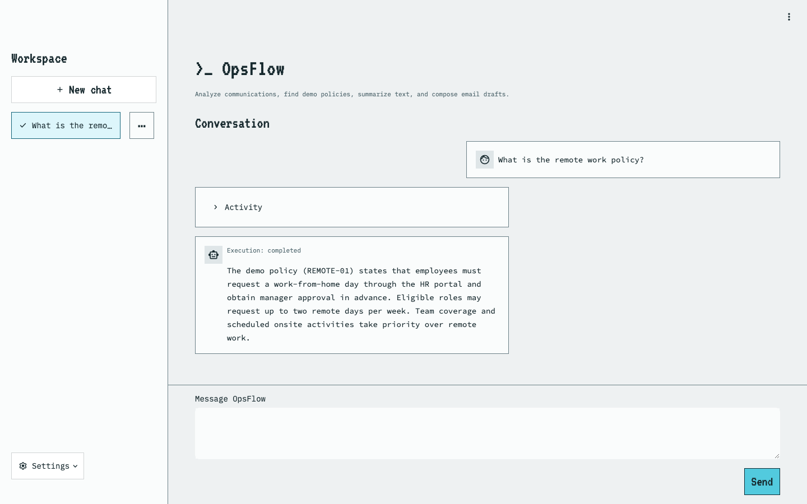

# OpsFlow-Agent

**An operations copilot that turns everyday requests into observable tool executions.**

OpsFlow-Agent helps an operations team understand a complaint, extract its main
topics, summarize an incident, look up a demo employee policy, prepare an email,
or schedule a one-time reminder—all from a persistent chat workspace.

It combines a local intent classifier with a bounded language-model agent. Local
tools handle scoring and retrieval; Groq-hosted models interpret requests and
produce summaries, drafts and explanations. Each turn exposes the tools, inputs,
results and timings in **Activity**, so the user can inspect what happened.

[Watch the narrated walkthrough](media/opsflow-walkthrough.mp4) ·
[User guide](docs/user-guide.md) ·
[API contract](docs/chat-api.md) ·
[Temporary hosted demo](https://opsflow-temporary-demo.onrender.com)

The hosted demo requires a password from the project owner. It is a shared,
fictional workspace with disposable storage and disabled email delivery.

**Explore:** [Capabilities](#what-you-can-do) · [Architecture](#how-a-request-becomes-work) ·
[Local setup](#run-locally) · [API](#api-at-a-glance) ·
[Evaluation](#evaluation-what-the-numbers-mean) · [Deployment](#docker-and-hosted-deployment)



The [narrated walkthrough and chapter guide](media/walkthrough.md) cover three
live requests across all six tools, saved pages and refresh restoration.

## What you can do

| Capability | Example request | What happens |
| --- | --- | --- |
| Sentiment analysis | `Check the sentiment of this: The service failed twice today and I am frustrated.` | VADER scores the supplied English text; the reply explains its tone. |
| Keyword extraction | `Find keywords in this: The server failed after the deployment.` | YAKE returns up to five ranked phrases. Lower scores mean greater relevance, not confidence. |
| Policy lookup | `What is the remote work policy?` | Local retrieval searches 25 fictional employee policies and returns a match, candidate questions or no match. |
| Summarization | `Summarize this update: The deployment failed on Tuesday. The team rolled back the release. Service was restored at 10 am.` | A model-backed tool produces a structured summary and key points. |
| Email drafting | `Draft a short professional email to Alex saying the deployment failed on Tuesday and service was restored at 10 am.` | A model-backed tool creates a recipient, subject and body, with separate review and sending instructions. |
| Reminder scheduling | `Remind me tomorrow at 10 am in Asia/Kolkata to review the deployment report.` | The agent validates the request and stores one reminder with an exact due time and timezone. |

**A draft is not a sent email. A scheduled reminder is not a delivered reminder.**
Chat does not send email or start the separate delivery worker. Policy answers
describe fictional demo data, not a real employer's rules.

### Three examples to explore

**1. Look up a policy.**

> What is the remote work policy?

Read the answer, then expand Activity to inspect `retrieve_faq` and the exact
stored policy. Unsupported or ambiguous questions may require clarification;
retrieving a similar policy does not establish every detail in a question.

**2. Turn a complaint into a useful response.**

> Analyze the sentiment, extract keywords, summarize this complaint, and draft a professional email to Alex about it: The service failed twice today and I am frustrated. The team rolled back the release and service was restored at 10 am.

This asks for four operations. The agent selects tools sequentially and can use
earlier observations in later steps. Inspect Activity for the actual calls to
`analyze_sentiment`, `extract_keywords`, `summarize_text` and `draft_email`.
Review the draft before copying it into your email application.

**3. Schedule follow-up work.**

> Remind me tomorrow at 10 am in Asia/Kolkata to review the deployment report.

The reply should show the saved task and its resolved date, time, UTC offset and
timezone. Open **Settings → Reminders** to inspect its current delivery state.
Missing dates or times require clarification. One reminder per turn is supported.

These examples demonstrate supported requests, not guaranteed model responses
or routing decisions. Provider failures and incomplete work remain visible.

## The user experience

1. Open the app and choose **New chat**, or continue a saved conversation.
2. Enter an ordinary-English request in **Message OpsFlow** and press **Send**.
3. Watch live Activity for classification, routing and model/tool stages.
4. Read the answer and expand the completed Activity panel for exact saved results.
5. Return to the conversation later. Refresh and restoration read saved records
   without executing the request again.

Workspace supports persistent titles, rename and confirmed deletion. Context is
restored across backend restarts while the same database remains available.
Unsent multiline drafts are held separately for each chat during the browser
session; they are not durable drafts across refreshes or restarts.

The Settings menu provides:

- **Docs:** examples, execution behavior and recovery guidance.
- **Emails:** successful saved email drafts, their source chats and review actions,
  including drafts retained from partially failed compound turns.
- **Reminders:** stored tasks, due times and actual delivery states.
- **Evaluations:** saved classifier results and a small generation-quality review.

These pages read existing records. Opening or refreshing them does not run a
model, recreate a draft, schedule a reminder or deliver email.

## How a request becomes work

### 1. Classify the request locally

A word TF-IDF pipeline and sigmoid-calibrated linear SVM predict one of eight
intents: sentiment, keywords, FAQ retrieval, summarization, email drafting,
reminder creation, compound requests and out-of-scope requests.

The saved model and metadata live in `artifacts/models/`. Runtime loading verifies
their association using SHA-256. The saved routing threshold is **0.71**.
The classifier is trained separately; normal chat does not retrain it.

### 2. Choose a fixed workflow or the agent

| Path | When it applies | Execution |
| --- | --- | --- |
| Fixed workflow (`llm_assisted`) | High-confidence sentiment, keyword or FAQ chat requests | Model extracts the source/question → local tool executes → model presents a grounded result. |
| Agent (`agent`) | Lower-confidence, contextual, compound, writing or reminder requests | A bounded ChatGroq tool-calling loop chooses validated tools and consumes their observations. |
| Local FAQ (`direct`) | A safely extracted, high-confidence question to the separate FAQ-only API | Local classification and retrieval, without a model call or chat history. |

Fixed workflows clarify missing input. When extraction determines that a request
needs context or multiple operations, it can hand the unchanged request and
conversation history to the agent. Extraction or tool failures stop accurately;
they do not silently retry through another route. A failed presentation retains
the successful local result as a partial failure.

The agent has an allowlist of six tools, strict argument validation, sequential
execution, at most **six orchestration calls**, **five tool attempts**, and a
**soft 120-second budget**. Writing tools make additional model calls within the
shared deadline. A qualifying rate-limit rejection can wait and retry that model
request once; completed tools and entire turns are not automatically repeated.

### 3. Stream observable progress and save the outcome

Streamlit submits once through `POST /api/v1/chat/stream`. FastAPI emits
server-sent events for real execution stages, then finalizes the turn in SQLite
before returning a saved terminal outcome. Live events are transient; restored
Activity uses saved tool/workflow records. It does not display private model reasoning.

HTTP transport success, task success and successful persistence are distinct.
For example, an SSE connection can return HTTP 200 while its terminal event
reports failed execution. A later tool failure preserves earlier observations.
Disconnecting the browser does not cancel backend execution.

## Run locally

### Requirements

- Python **3.12**; the pinned development/container version is **3.12.13**.
- macOS or Linux for the current Unix file-lock storage/worker implementation.
- A Groq API key for conversational chat, including fixed language workflows.
- Network access for Groq calls. Local scoring, retrieval and saved-record reads
  have no model-provider dependency.

Run commands from the repository root. The trained classifier and demo policy
data are already included; retraining is not a startup requirement.

```bash
git clone https://github.com/orbin123/opsflow-agent.git
cd opsflow-agent
python3.12 -m venv .venv
source .venv/bin/activate
python -m pip install -r requirements.txt
```

Create a local `.env` file:

```dotenv
GROQ_API_KEY=your_groq_api_key
```

The backend's model helpers load the repository-root `.env` lazily, without
overriding existing environment variables. Keep credentials out of Git.

Start the API in one terminal:

```bash
source .venv/bin/activate
python -m uvicorn app.main:app --host 127.0.0.1 --port 8000 --no-access-log
```

Start the UI in another terminal:

```bash
source .venv/bin/activate
python -m streamlit run streamlit_app.py --server.address 127.0.0.1
```

Open [the local app](http://127.0.0.1:8501). The backend exposes
[health](http://127.0.0.1:8000/health) and
[interactive API documentation](http://127.0.0.1:8000/docs).

Use **one backend process** per chat database. Do not add multiple Uvicorn workers
against the same SQLite files. Native local endpoints are intended for trusted
local use and do not provide authentication.

### Configuration

Set process-specific settings in the shell launching that process; do not assume
Streamlit or storage configuration will be loaded from the backend's model `.env`.

| Variable | Default / purpose |
| --- | --- |
| `GROQ_API_KEY` | Required for model-backed execution. |
| `GROQ_AGENT_MODEL` | Agent model; defaults to `openai/gpt-oss-20b`. |
| `GROQ_SENTIMENT_MODEL`, `GROQ_KEYWORD_MODEL`, `GROQ_FAQ_MODEL` | Fixed-workflow models; same default. |
| `GROQ_SUMMARY_MODEL`, `GROQ_EMAIL_MODEL` | Writing-tool models; same default. |
| `OPSFLOW_API_URL` | Streamlit backend URL; `http://127.0.0.1:8000`. |
| `OPSFLOW_CHATS_DB` | Chat/profile storage; `var/chats.sqlite3`. |
| `OPSFLOW_REMINDERS_DB` | Reminder storage; `var/reminders.sqlite3`. |
| `OPSFLOW_TIMEZONE` | Reminder default; `Asia/Kolkata`. Explicit request zones override it. |
| `OPSFLOW_TEMPORARY_DEMO` | `1` enables the hosted-demo storage/delivery notice. |

The code also accepts `openai/gpt-oss-120b` for the model overrides above; other
names fail configuration validation. Actual provider availability and account
limits still apply. Model settings and failure contracts are documented in the
[agent guide](docs/agent-loop.md) and individual workflow docs.

### Optional reminder delivery

Chat scheduling only writes a record. Local delivery requires an explicitly
started worker and Gmail SMTP configuration: `SMTP_USERNAME`, `SMTP_PASSWORD`
(app password), and `OPSFLOW_USER_EMAIL` (the configured recipient).

```bash
# Start only when you intend to submit due reminders to the configured mailbox.
python -m app.reminders.reminder_worker
```

Use the same reminder database and timezone configuration as the backend. The
worker owns a Unix lock and records delivery attempts durably. Only definite
transient pre-submission failures use its three-attempt retry budget; unknown
outcomes do not retry automatically. **SMTP acceptance does not prove inbox
arrival.** See [reminders](docs/reminders.md) and
[email transport](docs/email-notifications.md) before enabling delivery.

## Storage and recovery

Chat SQLite stores conversations, exact prompts/outcomes, execution details and
one fictional employee profile (`EMP-001`). All connected browsers share this
singleton workspace. The profile is not login, access control or per-user isolation.

Reminder SQLite is separate. Saved email drafts are projected from successful
tool results in retained chats, rather than duplicated in a draft database.
Deleting a chat removes its messages and saved drafts; it does **not** cancel or
delete reminders.

A retained `turn_id` prevents duplicate execution of the same submitted turn,
including after restart. A new submission has a new identity and may create new
work even if its text is identical. Running or unsaved work locks navigation and
submission. Recovery controls read saved state; they do not resubmit automatically.

This storage contract supports one backend on one local filesystem. Network
filesystems, multiple hosts and replacing active lock files are unsupported.
See [chat persistence](docs/chat-persistence.md) for interrupted and unsaved outcomes.

## API at a glance

| Method and path | Purpose |
| --- | --- |
| `GET /health` | Process health response. |
| `POST /api/v1/chat` | Execute one chat turn with a structured final response. |
| `POST /api/v1/chat/stream` | Execute one turn with live SSE progress. |
| `POST /api/v1/chats` | Create an empty saved chat. |
| `GET /api/v1/chats` | List saved chat metadata. |
| `GET /api/v1/chats/{session_id}` | Read a chat and its saved turns. |
| `PATCH /api/v1/chats/{session_id}` | Rename a chat. |
| `DELETE /api/v1/chats/{session_id}` | Delete a chat after client confirmation. |
| `POST /api/v1/faq` | Stateless, wholly local FAQ routing/retrieval. |
| `GET /api/v1/profile` | Read the singleton demo employee. |
| `GET /api/v1/reminders` | Read stored reminders and delivery states. |
| `GET /api/v1/evaluations` | Read validated saved classifier results. |
| `GET /api/v1/evaluations/generation` | Read the saved generation-quality sample. |
| `GET /metrics` | Prometheus metrics. |

For example, submit a turn once:

```bash
curl -N http://127.0.0.1:8000/api/v1/chat/stream \
  -H 'Content-Type: application/json' \
  -d '{"session_id":"readme-demo","turn_id":"policy-example-1","message":"What is the remote work policy?"}'
```

Use the same chat ID for context. Reusing the exact retained turn ID/message
replays its saved outcome; conflicting reuse returns a conflict. IDs are
identifiers, not authentication credentials. See the [chat API](docs/chat-api.md)
for status codes, event fields and persistence errors.

## Project structure

```text
app/
  api/             FastAPI request/response contracts and endpoints
  core/            Intent classifier, execution routing and bounded agent loop
  chat/            Persistent chats, context, SSE and singleton profile
  tools/           Analysis, retrieval, writing, scheduling and email utilities
  workflows/       Fixed extraction → local tool → presentation flows
  routes/          Conservative deterministic execution gates
  reminders/       Chat scheduling adapter, catalogue and delivery worker
  ui/              Streamlit clients, components and saved-record presentation
  evaluation/      Read-only classifier and generation-review readers
  observability/   Sanitized logs and process-scoped metrics
artifacts/models/  Trusted classifier pipeline and provenance metadata
data/              Synthetic intent data, fictional policies and reviewed sample
notebooks/         Classifier training, calibration and evaluation notebook
ui/                Local styles and licensed fonts
tests/             Offline regression suite
deploy/            Container supervisor and nginx configuration
monitoring/        Prometheus and provisioned Grafana configuration
docs/              Feature contracts, user guidance and implementation record
streamlit_app.py   Chat workspace entry point
Dockerfile         Pinned Python runtime image
```

The [package guide](docs/package-structure.md) explains module boundaries.
`requirements.txt` includes development/testing/notebook dependencies;
`requirements.runtime.txt` contains the deployment runtime subset.

## Evaluation: what the numbers mean

The classifier uses **1,000 synthetic labelled requests**, balanced across eight
intents. Its deterministic stratified split contains 800 development examples
and 200 holdout examples, with 25 holdout examples per intent.

| Recorded classifier measure | Value |
| --- | ---: |
| Holdout accuracy | 88.00% |
| Macro F1 | 0.8813 |
| Selected routing threshold | 0.71 |
| Correct labels among historical threshold-accepted cases | 47 / 47 |
| Historical threshold coverage | 23.5% |

These are same-source synthetic holdout results. Threshold acceptance is a
historical classifier measure, not end-to-end task success or proof of perfect
future precision. See the [training notebook](notebooks/train_evaluate_svm.ipynb)
and [saved metadata](artifacts/models/intent_router_svm_metadata.json).

Generation quality is a separate **AI-reviewed development sample**: five
available answers from eight planned cases. The saved review reports faithfulness,
coverage, relevance, instruction compliance, status accuracy and context relevance
on a 0–3 scale, with explicit reviewed/applicable counts. Missing outputs remain
unscored. It is not an independent human benchmark or an overall agent accuracy.

The review retains a real limitation: one contractor-policy answer acknowledges
missing eligibility details but reports `completed` where clarification was
expected. The Evaluations page reads saved evidence; it never runs or retrains
models. See [evaluation methodology and limitations](docs/evaluation.md).

## Verification and observability

Run the offline regression suite and dependency check:

```bash
python -m pytest -q
python -m pip check
```

Tests use controlled provider/transport doubles and isolated storage. They cover
routing, extraction, structured outputs, partial failures, persistence, duplicate
prevention, reminders, API/SSE contracts and Streamlit navigation. Passing them
does not establish arbitrary live-model quality or real email delivery.

GitHub Actions runs the offline suite, dependency checks, a Linux AMD64 Docker
build and container authentication smoke checks. The recorded combined release
passed **1,233 tests** on 15 October 2026; this is historical verification, not a
claim that a new checkout has just been tested.

The backend emits sanitized JSON request/task/tool/persistence logs and Prometheus
metrics. Request IDs connect observable events; the dedicated logger excludes
prompt bodies, drafts, credentials and raw tool content. Task execution,
HTTP transport and persistence have separate counters. Counters reset on restart;
saved replay does not count as new work.

```bash
docker compose -f compose.monitoring.yaml up -d
```

This starts Prometheus/Grafana only. Its default scrape target is a separately
started backend on port **8011** through Docker Desktop's
`host.docker.internal`. Adjust that target if using the quick-start port 8000.
See [monitoring setup](docs/monitoring.md).

## Docker and hosted deployment

The container supervisor runs one loopback API, Streamlit and a public nginx
proxy as an unprivileged user. The proxy protects UI HTTP requests and WebSockets
with Basic authentication; backend, metrics and OpenAPI routes are not exposed.

```bash
docker build --platform linux/amd64 -t opsflow-demo:local .
docker run --rm -p 127.0.0.1:10000:10000 \
  --env-file /absolute/path/to/demo-runtime.env opsflow-demo:local
```

Create that runtime file outside Git with `GROQ_API_KEY` and
`OPSFLOW_DEMO_PASSWORD` (16–72 bytes, no line breaks). Sign in with username
`opsflow`. Do not pass the development `.env` wholesale. The image excludes local
credentials/databases, and the launcher removes SMTP settings and never starts
the reminder worker.

The configured Render Free demo builds from `main` after CI checks pass. Cloud
SQLite data is disposable on sleep, restart or redeploy, and all viewers share
the workspace. Render's shutdown window can interrupt long in-flight turns.
See [deployment](docs/render-demo.md) and [CI/CD](docs/cicd.md) for the recorded
release, checks and rollback procedure.

## Practical limits

- English-focused analysis; short, sarcastic or mixed sentiment can be misleading.
- Fictional policy retrieval is lexical and may abstain on valid paraphrases.
- Models can misunderstand context, omit facts or choose the wrong tool. Structured
  schemas constrain shape, not semantic correctness.
- Requests and supplied source text are sent to Groq when model-backed stages run.
  Saved chats and Activity contain the supplied text and generated results.
- No multi-user login, per-user isolation or distributed backend storage.
- No chat email sending, recurring reminders, or reminder edit/cancel/retry UI.
- No production availability guarantee; provider limits and the bounded agent
  budget can stop a multi-step request before it finishes.

## Further reading

| To understand… | Read… |
| --- | --- |
| User prompts, saved pages and recovery | [User guide](docs/user-guide.md) |
| Local console and live Activity | [Streamlit console](docs/streamlit-console.md) |
| Tool selection, limits and failures | [Agent loop](docs/agent-loop.md) |
| Fixed language workflows | [Sentiment](docs/sentiment-workflow.md), [keywords](docs/keyword-workflow.md), [FAQ](docs/faq-workflow.md) |
| Structured writing | [Summarization](docs/summarization.md), [email drafting](docs/email-drafting.md) |
| Storage, replay and ownership | [Chat persistence](docs/chat-persistence.md), [employee workspace](docs/employee-profile.md) |
| Scheduling and delivery states | [Reminders](docs/reminders.md) |
| Current project decisions | [Implementation plan](docs/PLAN.md), [change record](docs/agents_doc.md) |

Feature documents retain historical slice-level verification notes. Current code,
later integration sections and the latest release records describe the shipped
behavior; an early “not integrated yet” note is not the current feature boundary.
